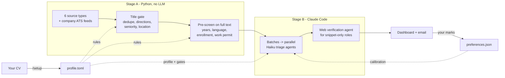

# Job Radar

**A daily job-search agent that reads your CV, searches six kinds of job sources plus hundreds of company career pages, throws out what you can't apply to (language requirements you don't meet, senior roles, student-only internships, the same job posted five times), and has parallel Claude agents rank the rest against your profile.** You get a dashboard and a short email of the jobs worth your time.

Languages, countries, career stage and target roles are all set in your own profile.

Built with [Claude Code](https://claude.com/claude-code). Python does the cheap, deterministic work for free; the LLM is used only where judgment is needed.

```
~131,000 listings seen  ->  13,123 stored  ->  1,963 ranked by LLM  ->  123 high fit
        (title rules)       (full-text rules)     (Claude Haiku agents)
```

---

## Why I built it

I was job hunting in Germany as an English-speaking graduate. The problem was not finding job boards, it was the noise: most postings were senior, required fluent German, wanted current students only, or were simply in the wrong field, and each board showed the same jobs again. Reading them by hand cost hours a day and I still missed roles that were only on company career pages.

So I treated it like a commercial analytics problem: pull every source into one dataset, clean and dedupe it, apply the hard rules as code, use an LLM only for the judgment calls, and close the loop with my own decisions.

## What it does

- **Collects** postings daily from the German federal job board (Bundesagentur für Arbeit), Arbeitnow, Workable, englishjobs, optionally LinkedIn, and the public job feeds of company applicant tracking systems (Greenhouse, Lever, Ashby, Personio, Recruitee, SmartRecruiters).
- **Discovers company career boards by itself**: any ATS link it sees becomes a feed it reads every day, and it guesses boards for companies seen elsewhere, accepting a guess only when the feed contains a role it already saw from that company. My registry grew to 132 boards in a week without any manual input.
- **Deduplicates** across sources and days (same URL, or same normalized company + title).
- **Pre-screens with rules, not tokens**: seniority, "3+ years required", fluent-German requirements, German-written postings, internships that require enrollment, work-permit and visa wording, location. Everything is driven by your profile.
- **Ranks with parallel LLM agents**: the survivors are cut down to their tasks and requirements sections and sent in batches to up to 18 Claude Haiku sub-agents at once. Each returns structured gates (work authorization, internship eligibility, experience, language) and a fit level.
- **Verifies thin listings on the web**: a role known only from a short snippet is looked up on the employer's own site by a separate agent, then re-screened on the real text. (I added this after the data showed snippet-based fit calls were too optimistic: of 12 snippet roles whose full posting was found, 8 failed on years or language.)
- **Learns from you**: mark jobs as applied or delete them with a reason on the dashboard; those choices go back into the ranking prompt as calibration examples.
- **Reports**: a self-contained HTML dashboard with filters, and an optional daily email that is sent even on empty days, so a missing email means a failed run.

## How it works



| Stage | Runs where | Cost | Output |
|---|---|---|---|
| A: collect + pre-screen | any scheduler (Task Scheduler, cron) | free | `data/seen_jobs.json`, run log |
| B: rank + verify | Claude Code (`/daily-rank`, or headless `claude -p`) | about 4k Haiku tokens per ranked posting | fit and gate verdicts |
| Report | Python | free | `reports/dashboard.html`, email |

### Design decisions

- **LLM only for judgment.** In my first week, deduplication and title rules dropped about 90% of everything the sources returned, and the full-text rules then removed 85% of what was stored, all before any model call. The LLM sees a trimmed excerpt, not the whole page, and never browses during ranking.
- **Hard gates vs. soft caveats.** A clear "5+ years" or "fluent German" excludes at any fit. Ambiguous wording ("2-3 years", a German-written posting that only asks for B1) keeps a job only when the fit is high.
- **Untrusted input.** Job postings and web pages are treated as data. Ranking agents get only Read and Write; the verification agent's prompt tells it to ignore instructions found on pages.
- **Reliability over speed.** Collection runs outside Claude in the OS scheduler, catches up if the PC was asleep, and takes over a stale lock from a crashed run; stage B checks that today's collection finished before ranking.
- **Personal rules in config, not code.** Everything about one person lives in `profile.toml`, so anyone can fork it.

## Quick start

Requirements: Python 3.11+, [Claude Code](https://claude.com/claude-code) for ranking, and optionally `pip install pypdf` to read a PDF CV.

```bash
git clone https://github.com/<you>/job-radar.git
cd job-radar
pip install -r requirements.txt
```

1. **Add your CV.** Put it in `profile/` (`.pdf`, `.docx`, `.md` or `.txt`).
2. **Create your profile.** Open the folder in Claude Code and run `/setup`. It reads the CV, asks which countries, internships and directions you want, writes `profile/profile.toml`, and tests it. (Or copy `profile/profile.example.toml` and edit it by hand.)
3. **Check it.**
   ```bash
   python radar.py profile-check --title "Junior Marketing Analyst" --title "Senior Director Sales"
   ```
4. **First run.** `python radar.py collect` (the first run takes longest), then `/daily-rank` in Claude Code.
5. **Open** `reports/dashboard.html`.

Your CV, profile and all collected data are git-ignored, so they stay on your machine even if you push your fork.

## Run it every day

**Windows:** create a Task Scheduler task that runs `scripts\run_daily_collect.cmd` every morning (tick "run as soon as possible after a scheduled start is missed"). Then schedule the ranking a few hours later, either as a Claude desktop scheduled task with the prompt `/daily-rank`, or a second Task Scheduler task running `claude -p "/daily-rank"` in the repo folder.

**macOS / Linux:** `scripts/run_daily.sh` runs both stages; add it to cron, e.g. `0 10 * * * /path/to/job-radar/scripts/run_daily.sh`.

### Daily email (optional)

Set `digest.enabled = true` in your profile and set two environment variables yourself (they are never stored in the repo):

```bash
JOB_RADAR_SMTP_USER=you@gmail.com
JOB_RADAR_SMTP_PASSWORD=<a Gmail app password>
```

For Gmail, the app password needs 2-Step Verification. Other providers: set `digest.smtp_host` / `smtp_port`.

## Your profile

`profile/profile.example.toml` is fully commented. The main parts:

| Section | What it controls |
|---|---|
| `[candidate]` | career stage (student / graduate / experienced), years of experience, and the factual summary the ranking agents read |
| `[scope]` | countries to search, where internships count, where you can work without visa sponsorship |
| `[languages]` | CEFR level per language; German below C1 switches on the German-requirement rules |
| `[rules]` | years threshold, senior titles, how to treat German-written postings, enrolled-only companies |
| `[directions]` | title keywords per direction group: the first, coarse filter |
| `[advantage]` | signals of a real edge (e.g. a native language employers ask for) |
| `[search]` | sources, keywords, Workable cities, LinkedIn terms |

## Commands

```
python radar.py collect          # stage A
python radar.py rank-prepare     # batches for the ranking agents (used by /daily-rank)
python radar.py rank-apply DIR   # write verdicts back
python radar.py dashboard        # rebuild the dashboard
python radar.py digest --dry-run # preview today's email
python radar.py sync FILE        # apply lines copied from the dashboard
python radar.py ats list         # company career boards found so far
python -m unittest discover -s tests
```

## Sources and fair use

All sources are public endpoints, called with fixed delays, backoff on rate limits and a hard stop after repeated limits. englishjobs' redirect links are disallowed by its robots.txt, so they are stored for you to click but never fetched. **LinkedIn is off by default:** the bundled CLI uses LinkedIn's public job pages, which its terms of service do not allow automated access to; enable it only for low-volume personal use, at your own responsibility.

The sources are strongest for Germany. Other countries in `jobradar/countries.py` are supported through Workable, company feeds and LinkedIn; adding a local job board means adding a collector in `jobradar/sources.py`.

## Credits

The LinkedIn CLI in `vendor/linkedin-search` and the job-record format come from [ai-job-search](https://github.com/MadsLorentzen/ai-job-search) by Mads Lorentzen (MIT), which this project grew out of. The daily multi-source pipeline, pre-screen, agent ranking, web verification, feedback loop and profile system are my own work, built with Claude Code.

MIT License.
